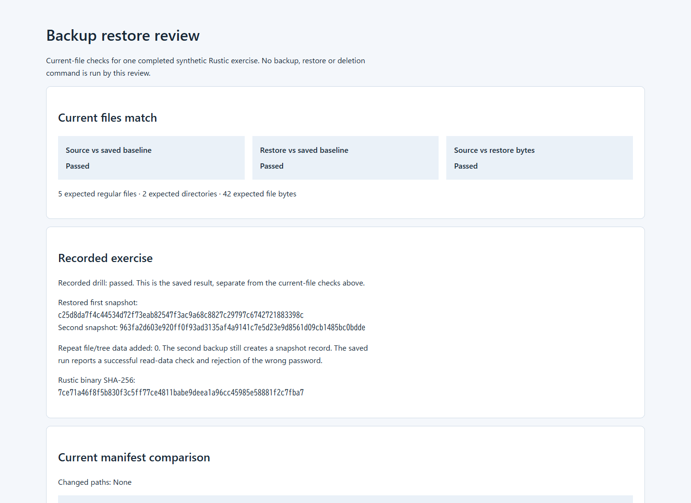

# Backup Restore Drill

Run a synthetic backup and restore with the actual Rustic engine, then inspect
the restored paths and bytes in an offline report. The exercise creates its own
files; it does not take a real-data source directory.



## Try it on Linux

Requirements: Rust/Cargo 1.99.0 on `PATH`, Python 3.12 and a working native Rust
build toolchain, including a linker. The recorded environment is Ubuntu 24.04
x86_64. Locked registry dependencies need internet access if not cached.
No account, cloud service or Docker is needed.

```sh
git clone https://github.com/skyon0522-ai/backup-restore-drill.git
cd backup-restore-drill
python3 tools/run_drill.py /tmp/backup-drill
```

Choose a new work directory outside the checkout whose parent exists. The
runner checks source identities, runs the Python/Rust tests, builds both Rust
executables, backs up the generated fixture twice, checks repository data and
restores the first snapshot. It then rechecks the current files and prints the
path to `review/report.html`. Open that file in a browser; no server or JavaScript
is used. Existing output is never replaced; failed runs retain logs and partial
new output. Use another work-directory name for another exercise.

The first build is substantial. Later runs reuse the build cache at
`$XDG_CACHE_HOME/backup-restore-drill/target` or
`$HOME/.cache/backup-restore-drill/target`. Standard `CARGO_TARGET_DIR` overrides
it. Keep cache, checkout and work directory separate. Builds default to two
jobs; an existing `CARGO_BUILD_JOBS` setting is honored. The runner does not
delete the cache, receipts or backup repository.

## Inspect two recorded results

| Result | What it demonstrates |
| --- | --- |
| [Matching current files](examples/matched/report.html) | Five regular files, two directories and 42 file bytes match the saved baseline and each other. |
| [Changed restored byte](examples/mismatch/report.html) | A copied restore input has one changed byte, preserving its size and modification time. Current checks fail while the original recorded success remains visible. |

Clone/download the repository to open these HTML files locally; GitHub displays
their source. Each example contains six review files. These are recorded
inspection outputs, not backup images. The changed example comes from an
inspection copy of one completed real run, not another backup/restore command.

The report separates source vs saved baseline, restore vs saved baseline, and
literal source/restore bytes. It includes empty directories and flags added,
missing or changed paths. Saved engine results are displayed separately:
a historical `passed` value does not make a changed restore pass current checks.

For a read-only recheck, use `python3 tools/review_run.py COMPLETED_RUN_DIRECTORY
NEW_REVIEW_DIRECTORY` with actual paths. The new output must be outside the run,
and its parent must exist. Exit 0 means matched, 1 mismatch, and 2 invalid input
or incomplete output. The runner returns 0 on completion and 2 on a failed gate
or preflight. Use `--help` on either Python command.

Review files contain names, sizes, digests, snapshot IDs and selected recorded
checks. They omit file contents, passwords, repository keys and the original
machine-specific CLI path. Inspect metadata before sharing. The original run
retains its actual repository, generated files and command logs separately.

## What passed

On **2026-10-15 (JST)**, the composed CLI built in an initially empty Cargo target
in 661.3 seconds with two jobs. The registry cache was reused offline; fresh
dependency acquisition and a clean OS installation were not exercised. The new
entrypoint then reused that compiled target, passed the original four Rust tests
and 15 Python tests, and completed an actual backup/check/restore exercise. See
[the dated local record](verification/linux-review-20261015.json) and
[verification scope](VERIFICATION.md).

The first selected snapshot was restored after a second snapshot existed.
Repeated backup added zero file/tree data, the read-data check passed, the wrong
password failed for the expected reason, and the original drill compared paths,
SHA-256 and literal bytes. Current-file review detected both a same-size,
same-time changed byte and an extra path. Three report variants passed isolated
browser checks at widths 1440 and 390, including keyboard controls, print-visible
scope and escaped extra-file text.

[Historical CI run 38060129707](https://github.com/skyon0522-ai/backup-restore-drill/actions/runs/38060129707)
succeeded on 2026-10-10 at base commit
`b4ca7bde9a016832cb7c6d17a79822b9ee12a5e3`, before these new tools.
Consult [workflow runs](https://github.com/skyon0522-ai/backup-restore-drill/actions/workflows/checks.yml)
for a published commit's remote result; local records are separate.

## Scope and handling

The fixture uses **a fixed public demo password**, not a generated secret.
Use the exercise only for its generated data. The runner creates private new
work/review directories and refuses existing output. The reader executes no
backup, restore or deletion and does not authenticate editable saved records.
See [security boundaries and reporting](SECURITY.md).

The verified scope is regular synthetic files/directories on Linux. Metadata,
symlinks, special files, real business data, interrupted writes, power loss,
concurrent changes, cloud repositories, retention and production recovery are
not verified. The local backend is used exclusively. `--no-default-features`
disables CLI defaults but leaves backend default transport features compiled.
Minimal native-package prerequisites were not isolated on this existing Ubuntu
installation.

## Research background


Sean Quinlan and Sean Dorward, [Venti: A New Approach to Archival Data Storage](https://www.usenix.org/conference/fast-02/venti-new-approach-archival-data-storage), FAST 2002, describe content-addressed blocks and coalescing duplicate content. That storage property provides context for this drill's repeated-backup check: the copied Rustic engine reports no new file/tree data on the second backup of an unchanged input. The command flow and acceptance checks come from the pinned Rustic implementation and tests, rather than a new implementation of Venti. The drill checks restored paths and literal bytes; it does not reproduce Venti's performance results or establish a write-once storage policy.


<details>
<summary>Implementation and source map</summary>

| Entry point | Purpose |
| --- | --- |
| [tools/run_drill.py](tools/run_drill.py) | Linux build/test/drill orchestration with retained logs. |
| [tools/review_run.py](tools/review_run.py) | Current-file checks and offline report without engine or data mutation. |
| [Reader tests](tools/test_review_run.py) and [runner tests](tools/test_run_drill.py) | File/manifest, preflight and failure boundaries. |


| Start here | Purpose |
| --- | --- |
| [drill/src/main.rs](drill/src/main.rs) and [drill/](drill/) | Executable recovery exercise adapted from upstream subprocess tests |
| [app/Cargo.toml](app/Cargo.toml) and [app/](app/) | Copied CLI with local Cargo bindings |
| [components/rustic-cli/](components/rustic-cli/) and [components/rustic-core-workspace/](components/rustic-core-workspace/) | Unchanged CLI/core/backend source and original licenses |
| [DESIGN.md](DESIGN.md) and [PROVENANCE.md](PROVENANCE.md) | Exercise design, reuse boundary and exact pinned revisions |
| [VERIFICATION.md](VERIFICATION.md) and [verification-summary.json](verification-summary.json) | Observed checks, cache reuse and unverified conditions |
| [composition.diff](composition.diff) and [source-manifest.json](source-manifest.json) | Local dependency binding changes and copied-source identities |
| [tools/verify_source.py](tools/verify_source.py) | Read-only check of pinned component copies and adaptations |

Copied upstream guides retain their original site/license-relative routes, including some links that do not resolve from their nested GitHub location. For complete upstream documentation, use the pinned [Rustic CLI repository](https://github.com/rustic-rs/rustic/tree/143d073f6039fcf29b64191ceb36c926744b6fe4) and [Rustic core repository](https://github.com/rustic-rs/rustic_core/tree/6fa7b56ebc750c6af0e6bc6bbe90c1781b60a38d). This root README is the entry point for the assembled drill, rather than the retained upstream app README.


`app/` is the copied Rustic CLI. Its two Cargo files connect `rustic_core`, `rustic_backend`, and test-support `rustic_testing` to the unchanged `components/rustic-core-workspace/` source. `drill/src/main.rs` adapts the copied CLI subprocess tests into an executable exercise. Every init, backup, read-data check, wrong-password attempt, and restore runs the actual composed CLI. The drill supplies synthetic inputs and verifies results; Rustic owns the backup engine, repository storage, and cryptography.

The original 195-file CLI and 331-file core workspace copies remain in `components/`. Their source manifests, original test copies, licenses, and adaptation diffs are included. See [PROVENANCE.md](PROVENANCE.md) for exact pins and [VERIFICATION.md](VERIFICATION.md) for the original → duplicate → composition checks and staged reproduction.


The original drill, locks, composed app, copied components and licenses are
unchanged. The existing verifier retains the same byte/blob identity checks.

</details>

The adaptation uses Apache-2.0 OR MIT. Original license files are retained;
see [LICENSE.md](LICENSE.md) and [PROVENANCE.md](PROVENANCE.md).
